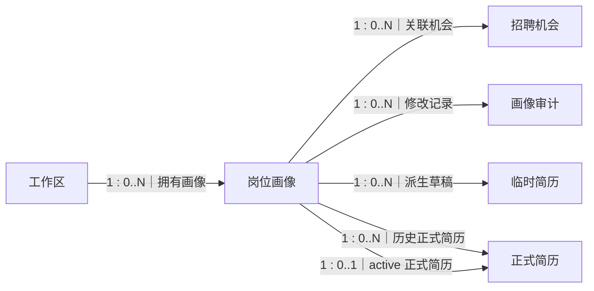
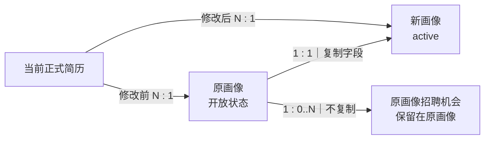
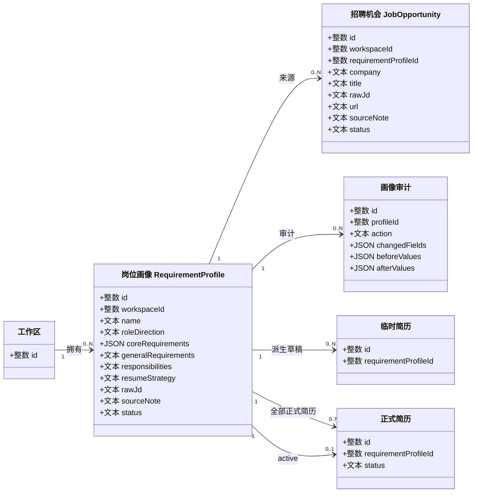

# 岗位画像中文关系图与 UML

> 文档状态：living-design（配套图册）

> 阅读方式：每条边按“左侧数量 : 右侧数量”读取。
>
> 本图不使用鸦脚符号。原总体英文图保留。

## 1. 关系图

自动复制画像时，原画像、原招聘机会不变；新画像默认没有机会，当前正式简历改指新画像。

## 2. UML 类图

## 3. 必要字段

### RequirementProfile

| 字段 | 中文含义 | 规则 |
| --- | --- | --- |
| `id` | 画像主键 | 稳定 ID |
| `workspace_id` | 工作区 | 必填外键 |
| `name` | 画像名称 | 必填 |
| `role_direction` | 岗位方向 | 可空 |
| `core_requirements_json` | 核心技术要求 | JSON 数组 |
| `general_requirements` | 一般要求 | 可空 |
| `responsibilities` | 主要职责 | 可空 |
| `resume_strategy` | 简历强调方向 | 可空 |
| `raw_jd` | 主参考 JD 文本 | 可空 |
| `source_note` | 来源备注 | 可空 |
| `status` | 生命周期 | active/archived/recycled/purged |
| `archived_at` | 归档时间 | 归档状态使用 |
| `recycled_at` | 回收时间 | 回收状态使用 |
| `purged_at` | 清理时间 | 终态使用 |
| `created_at` | 创建时间 | UTC ISO-8601 |
| `updated_at` | 修改时间 | UTC ISO-8601 |

### JobOpportunity

| 字段 | 中文含义 | 规则 |
| --- | --- | --- |
| `id` | 机会主键 | 稳定 ID |
| `workspace_id` | 工作区 | 必须与画像一致 |
| `requirement_profile_id` | 所属画像 | 必填 |
| `company` | 公司 | 可空 |
| `title` | 招聘岗位名称 | 可空 |
| `raw_jd` | 招聘原文 | 可空 |
| `url` | 招聘链接 | 可空 |
| `source_note` | 来源备注 | 可空 |
| `status` | 生命周期 | active/archived/recycled/purged |
| `created_at` / `updated_at` | 时间 | UTC ISO-8601 |

### ProfileAuditEvent

| 字段 | 中文含义 |
| --- | --- |
| `id` | 审计事件 ID |
| `workspace_id` / `profile_id` | 所属工作区和画像 |
| `actor_user_id` | 操作者 |
| `action` | created/updated/archived/restored/recycled/purged/cloned/opportunity_changed |
| `changed_fields_json` | 变化字段 |
| `before_values_json` / `after_values_json` | 变化前后值 |
| `related_profile_ids_json` | 复制等操作的关联画像 |
| `reason` | 操作原因 |
| `created_at` | 事件时间 |
