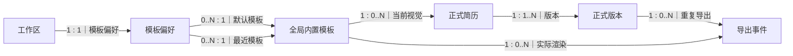
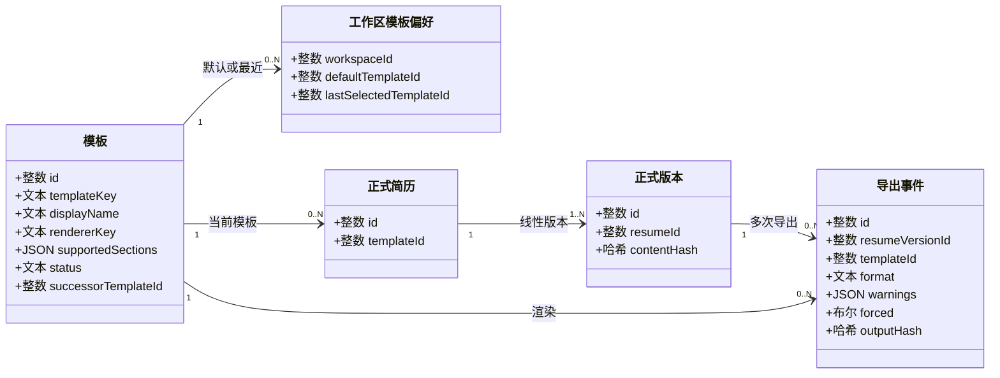
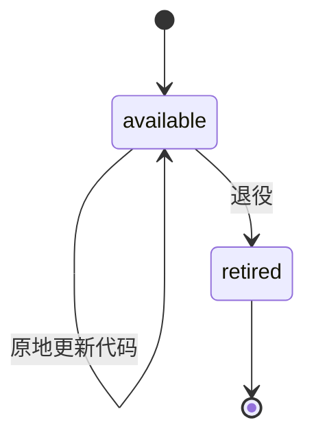
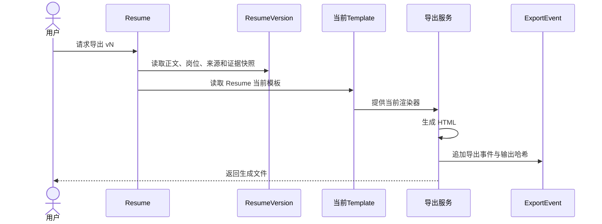

# 模板与交付中文关系图、UML 和时序

> 文档状态：living-design（配套图册）

> 所有关系边按“左侧数量 : 右侧数量”读取。本图不使用鸦脚符号。

## 1. 关系图

## 2. UML 类图

## 3. 模板生命周期

退役模板不能重新启用；已有 Resume 若仍引用退役模板，只能切换到可用模板或 successor。

## 4. 渲染与导出

同一版本再次导出时，正文业务内容保持一致，但模板升级可能改变视觉和 `output_hash`。

## 5. 必要字段

| 实体 | 必要字段 | 约束 |
| --- | --- | --- |
| Template | `id`, `template_key`, `display_name`, `description`, `renderer_key`, `supported_sections_json`, `default_sections_json`, `status`, `successor_template_id`, `updated_at` | template_key 全局唯一；只能依次退役 |
| WorkspaceTemplatePreference | `workspace_id`, `default_template_id`, `last_selected_template_id`, `updated_at` | 每工作区一行 |
| Resume | `template_id` | 当前 Resume 的视觉选择；不进入内容哈希 |
| ExportEvent | `id`, `workspace_id`, `resume_id`, `resume_version_id`, `template_id`, `format`, `warnings_json`, `forced`, `content_hash`, `output_hash`, `created_at` | 可重复；输出哈希逐次记录 |
