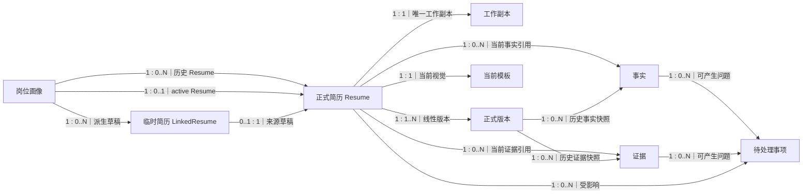
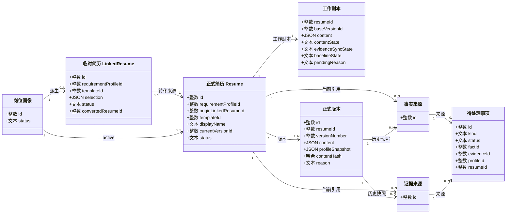
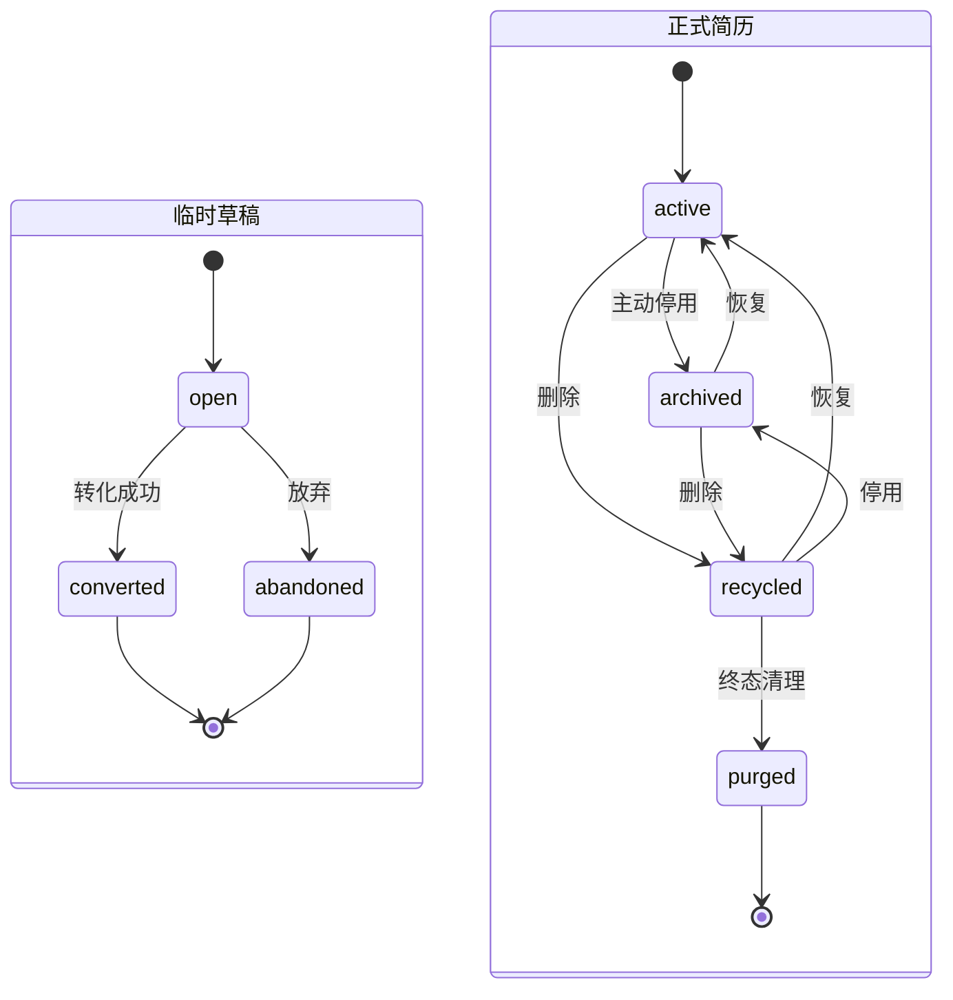
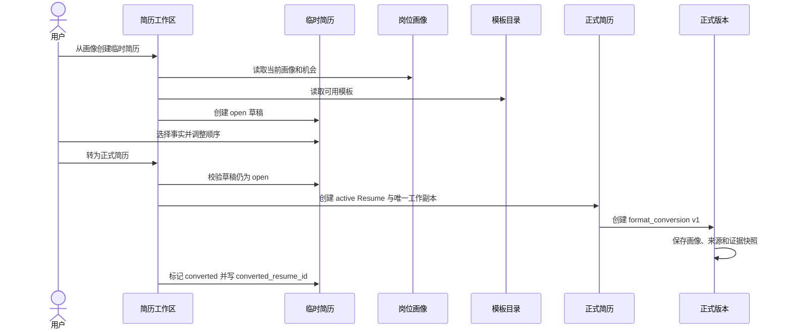
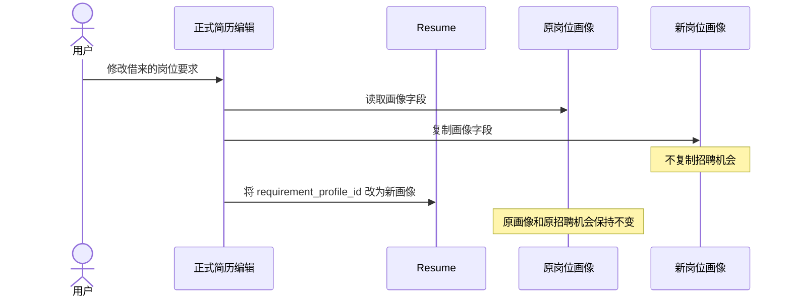
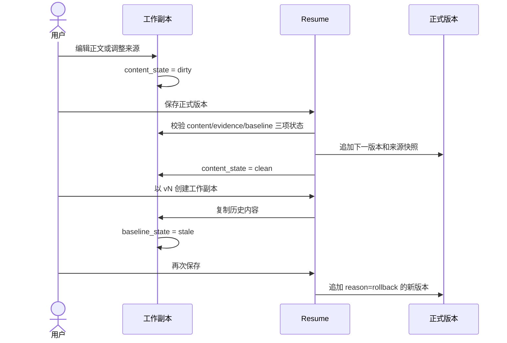

# 简历主链中文关系图、UML 与流程

> 文档状态：living-design（配套图册）

> 所有关系边按“左侧数量 : 右侧数量”读取。本图不使用鸦脚符号。

## 1. 核心关系

## 2. UML 类图

## 3. 状态机

## 4. 创建与转化时序

## 5. 简历内修改画像

## 6. 保存与恢复

## 7. 必要字段

| 实体 | 必要字段 | 关键约束 |
| --- | --- | --- |
| LinkedResume | `id`, `workspace_id`, `requirement_profile_id`, `template_id`, `selection_json`, `status`, `converted_resume_id`, `created_at`, `updated_at` | status 为 open/converted/abandoned；converted 必须指向 Resume |
| Resume | `id`, `workspace_id`, `requirement_profile_id`, `origin_linked_resume_id`, `template_id`, `display_name`, `current_version_id`, `status` | 每画像最多一份 active；草稿来源唯一 |
| ResumeVersion | `id`, `workspace_id`, `resume_id`, `version_number`, `content_json`, `profile_snapshot_json`, `source_manifest_json`, `evidence_manifest_json`, `content_hash`, `reason`, `created_at` | 版本号线性唯一；记录不可变 |
| WorkingCopy | `id`, `workspace_id`, `resume_id`, `base_version_id`, `template_id`, `content_json`, `content_state`, `evidence_sync_state`, `baseline_state`, `pending_reason` | 每 Resume 一份；三个状态维度正交 |
| ResumeFactUse | `resume_id`, `fact_id`, `section_code`, `block_key`, `display_order`, `fact_content_hash` | 当前编辑来源 |
| VersionFactSnapshot | `resume_version_id`, `fact_id`, `section_code`, `block_key`, `display_order`, `fact_content_hash` | 历史来源，不可变 |
| ResumeEvidenceUse | `resume_id`, `evidence_id`, `section_code`, `block_key`, `display_mode`, `label`, `display_order` | 展示方式属于引用 |
| VersionEvidenceSnapshot | `resume_version_id`, `evidence_id`, `section_code`, `block_key`, `display_mode`, `label`, `display_order` | 历史证据，不可变 |
| PendingIssue | `id`, `workspace_id`, `kind`, `status`, `fact_id`, `evidence_id`, `profile_id`, `resume_id`, `section_code`, `block_key`, `message` | 至少一个来源外键非空，不得跨工作区 |
