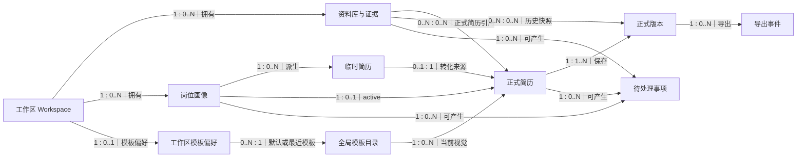

# ResumeCraft 系统关系总图

> 文档状态：living-design
>
> 用途：定义岗位画像、简历主链、模板交付和资料库之间的跨模块边界。
>
> 各模块内部字段与约束以其 `design.md` 和 `schema.sql` 为准。

## 1. 模块依赖

## 2. 跨模块关系

| 编号 | 左端 | 数量 | 右端 | 规则 |
| --- | --- | --- | --- | --- |
| SYS-REL-001 | Workspace | `1 : 0..N` | RequirementProfile | 画像归属一个工作区 |
| SYS-REL-002 | RequirementProfile | `1 : 0..N` | JobOpportunity | 每条机会只属于一个画像 |
| SYS-REL-003 | RequirementProfile | `1 : 0..N` | LinkedResume | 一个画像可有多份临时草稿 |
| SYS-REL-004 | RequirementProfile | `1 : 0..1` | active Resume | 同一画像最多一份 active 正式简历 |
| SYS-REL-005 | LinkedResume | `0..1 : 1` | Resume | 一份正式简历最多记录一个转化来源 |
| SYS-REL-006 | Resume | `1 : 1` | ResumeWorkingCopy | 每份正式简历只有一份工作副本 |
| SYS-REL-007 | Resume | `1 : 1..N` | ResumeVersion | 正式简历拥有线性不可变版本 |
| SYS-REL-008 | ResumeVersion | `1 : 0..N` | Fact/Evidence snapshot | 版本固定当时的业务来源 |
| SYS-REL-009 | Template | `1 : 0..N` | Resume | Resume 保存当前视觉偏好 |
| SYS-REL-010 | Workspace | `1 : 0..1` | WorkspaceTemplatePreference | 每工作区一份模板偏好 |
| SYS-REL-011 | ResumeVersion | `1 : 0..N` | ExportEvent | 同一版本可多次导出 |
| SYS-REL-012 | Fact/Evidence/Profile/Resume | `1 : 0..N` | PendingIssue | 待处理事项使用显式来源外键 |

## 3. 跨模块不变量

| 编号 | 不变量 |
| --- | --- |
| SYS-INV-001 | 所有对象必须属于同一工作区后才能建立关系。 |
| SYS-INV-002 | Resume 的 ID 是业务身份；`ResumeIdentity` 和 `identity_key` 只存在于迁移兼容层。 |
| SYS-INV-003 | 画像变化不自动改写 ResumeVersion；用户保存时形成新版本。 |
| SYS-INV-004 | Resume 内修改画像会复制新画像，不复制机会，原画像不变。 |
| SYS-INV-005 | 模板只参与当前渲染，不属于 ResumeVersion 内容哈希。 |
| SYS-INV-006 | 事实普通修改只生成 PendingIssue，不覆盖正式正文。 |
| SYS-INV-007 | 证据同步属于已确认的目标能力，当前标记为 target，不得在能力矩阵中写成 implemented。 |

## 4. Schema 组合

模块 SQL 需要在共享前置对象上按依赖组合：

1. 工作区、用户、事实、证据和模板的外部键；
2. `job-profile/schema.sql`；
3. `resume/schema.sql`；
4. `rendering-delivery/schema.sql`；
5. 执行 `PRAGMA foreign_key_check`。

`resume/schema.sql` 允许在 `templates` 表尚未创建时建立延迟 FK 声明；正式插入数据前，三个模块必须全部应用。设计契约测试使用临时 SQLite，不连接真实数据库。
