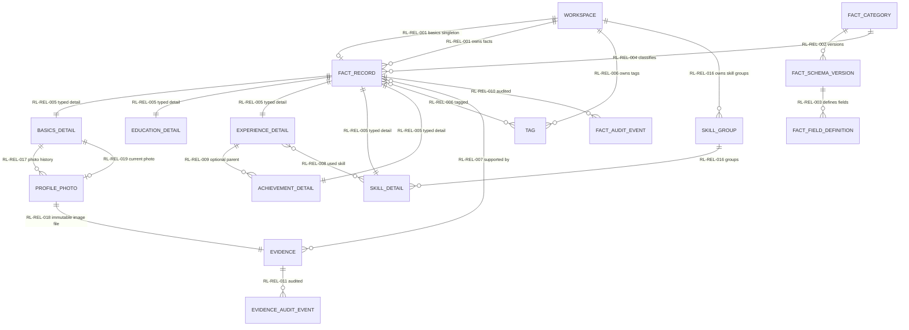
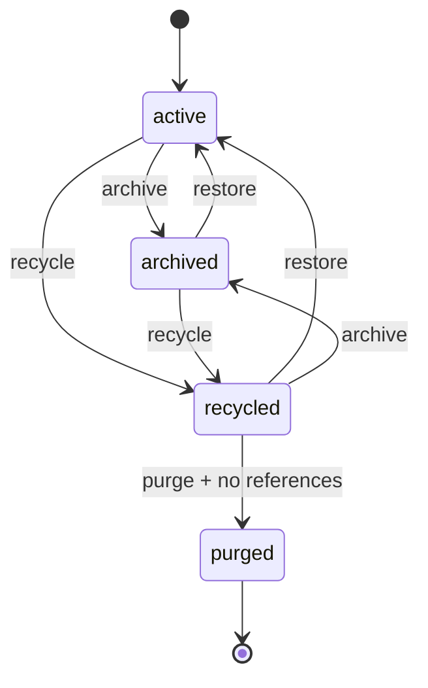
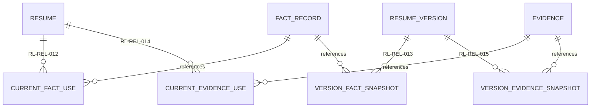

# 资料库关系规范

> 文档状态：living-design

> 文档状态：现行设计，资料库实体、字段、关系、状态与约束的唯一权威来源
>
> 上位依据：[功能设计书](../functional-design.md)
>
> 机器可读结构：[schema.sql](schema.sql)
>
> 中文审阅图册：[中文关系图、UML 类图与必要字段表](diagrams-zh.md)
>
> 2026-11-09 直接重构：资料事实收敛为五类。项目主页、代码仓库、演示视频和证书地址由证据承载并挂到经历或成果，不再建立独立的“链接”事实。正式简历对象命名为 `Resume`，跨模块边界以[简历主链模块规范](../domain/resume/design.md)为准。

## 1. 范围与效力

本规范定义 ResumeCraft 资料库的现行模型，应用模型、API、迁移和中文图册均以其为语义基准。

资料域包括：

- 工作区唯一的基本信息主档；
- 教育、经历、技能和成果事实；
- 挂接在事实上的文件、链接和说明证据；
- 受控分类、字段、标签和技能分组；
- 可复用证据及其与事实的关联；
- 事实与证据的追加式审计；
- 简历当前使用和正式版本快照需要的边界关系。

本规范不定义岗位画像、临时简历正文、正式版本正文、模板和 AI 编排。简历模块只通过本文定义的边界关系引用资料。

### 1.1 编号约定

| 前缀 | 含义 |
| --- | --- |
| `RL-ENT` | 实体或物理表 |
| `RL-FLD` | 受控字段 |
| `RL-REL` | 实体关系 |
| `RL-STS` | 状态机 |
| `RL-INV` | 不变量 |
| `RL-CMD` | 领域命令 |
| `RL-DEC` | 设计决策 |
| `RL-DAT` | 现有数据重组条目 |

编号一经发布不复用。删除的设计保留原编号并标记为 retired。

## 2. 概念 ER



| 实体编号 | 概念实体 | 说明 |
| --- | --- | --- |
| RL-ENT-001 | User | 本地或未来多用户操作者，仅作审计身份边界 |
| RL-ENT-002 | Workspace | 数据隔离和唯一基本信息主档的边界 |
| RL-ENT-003 | FactCategory | 系统维护的五个稳定分类 |
| RL-ENT-004 | FactSchemaVersion | 分类字段结构的不可变版本 |
| RL-ENT-005 | FactFieldDefinition | 分类字段、类型和显示顺序的受控定义 |
| RL-ENT-006 | FactRecord | 事实公共身份、业务键、生命周期和审计锚点 |
| RL-ENT-007 | BasicsDetail | 工作区基本信息主档 |
| RL-ENT-008 | EducationDetail | 教育经历 |
| RL-ENT-009 | ExperienceDetail | 项目、实习、竞赛、科研等主经历 |
| RL-ENT-010 | SkillGroup | 技能展示分组字典 |
| RL-ENT-011 | SkillDetail | 一项可复用能力 |
| RL-ENT-012 | AchievementDetail | 可独立展示的离散成果，可选依附经历 |
| RL-ENT-013 | LinkDetail | retired；项目链接改为 Experience/Achievement 下的 Evidence |
| RL-ENT-014 | FactExtensionValue | 受控字段定义下的事实扩展值 |
| RL-ENT-015 | Tag | 受控扁平标签 |
| RL-ENT-016 | TagAlias | 标签别名，用于统一历史叫法 |
| RL-ENT-017 | FactTag | 事实与标签关联 |
| RL-ENT-018 | Evidence | 文件名、链接、校验和或说明组成的可复用材料 |
| RL-ENT-019 | FactEvidence | 事实与证据关联 |
| RL-ENT-020 | FactAuditEvent | 事实字段级追加式审计 |
| RL-ENT-021 | EvidenceAuditEvent | 证据元数据和状态审计 |
| RL-ENT-022 | ExperienceSkillLink | 经历和技能的专用多对多关联 |
| RL-ENT-023 | ResumeReferenceBoundary | 正式 Resume 跨模块边界；完整定义归简历模块 |
| RL-ENT-024 | ResumeVersionBoundary | 正式版本边界锚点，完整定义归简历模块 |
| RL-ENT-025 | CurrentFactUse | 当前简历或工作副本使用的事实 |
| RL-ENT-026 | VersionFactSnapshot | 正式版本保存的事实引用快照 |
| RL-ENT-027 | CurrentEvidenceUse | 当前简历或工作副本使用的证据和展示方式 |
| RL-ENT-028 | VersionEvidenceSnapshot | 正式版本保存的证据引用快照 |
| RL-ENT-029 | ProfilePhoto | 个人档案照片关系；保留当前和历史照片 |

## 3. 分类、字段与业务身份

### 3.1 分类

五个分类代码固定为 `basics`、`education`、`experience`、`skill`、`achievement`。新增分类必须先增加登记、字段定义、模板适配和迁移，不允许在运行期插入用户自定义分类。

项目主页、代码仓库、演示视频、作品集和证书文件不是事实，而是 `evidence`。它们通过 `fact_evidence` 挂到相关经历或成果，并可在简历区块中按需展示。这样避免同一项目链接既是一条“链接事实”又是项目证据。

经历类型使用六类稳定代码：

| 代码 | 显示名 |
| --- | --- |
| `project` | 项目 |
| `work_internship` | 实习/工作 |
| `competition` | 竞赛 |
| `research` | 科研 |
| `campus_volunteer` | 校园/志愿 |
| `other` | 其他 |

成果类型使用五类稳定代码：

| 代码 | 显示名 |
| --- | --- |
| `honor` | 荣誉 |
| `certificate` | 证书 |
| `publication_patent` | 发表/专利 |
| `project_result` | 项目结果 |
| `other` | 其他 |

### 3.2 字段目录

`requirement_level=required_for_output` 只影响导出完整度检查，不阻止保存不完整资料。扩展字段必须先成为字段定义，再通过 `fact_extension_values` 填值。

`RL-FLD` 覆盖所有进入编辑、检索或导出语义的分类内容字段。主键、工作区、外键、时间和审计列属于实体维度，由对应 `RL-ENT`、`RL-REL`、`RL-STS` 和 SQL 表定义约束，不另造重复字段编号。

| 字段编号 | 分类 | key | 类型 | 输出要求 |
| --- | --- | --- | --- | --- |
| RL-FLD-001 | basics | `name` | text | required_for_output |
| RL-FLD-002 | basics | `phone` | text | recommended |
| RL-FLD-003 | basics | `email` | text | recommended |
| RL-FLD-004 | basics | `city` | text | optional |
| RL-FLD-005 | basics | `desired_city` | text | optional |
| RL-FLD-006 | basics | `birth_date` | date | optional |
| RL-FLD-007 | basics | `age_text` | text | optional |
| RL-FLD-008 | basics | `hometown` | text | optional |
| RL-FLD-009 | basics | `identity_status` | text | optional |
| RL-FLD-010 | basics | `graduation_date` | year_month | optional |
| RL-FLD-011 | basics | `availability` | long_text | optional |
| RL-FLD-012 | basics | `bio` | long_text | optional |
| RL-FLD-013 | education | `school` | text | required_for_output |
| RL-FLD-014 | education | `major` | text | optional |
| RL-FLD-015 | education | `degree` | text | recommended |
| RL-FLD-016 | education | `start_date` | year_month | optional |
| RL-FLD-017 | education | `end_date` | year_month | optional |
| RL-FLD-018 | education | `period_text` | text | optional |
| RL-FLD-019 | education | `gpa` | text | optional |
| RL-FLD-020 | education | `ranking` | text | optional |
| RL-FLD-021 | education | `achievement` | long_text | optional |
| RL-FLD-022 | education | `courses` | long_text | optional |
| RL-FLD-023 | experience | `experience_kind` | enum | required_for_output |
| RL-FLD-024 | experience | `period_text` | text | recommended |
| RL-FLD-025 | experience | `start_date` | year_month | optional |
| RL-FLD-026 | experience | `end_date` | year_month | optional |
| RL-FLD-027 | experience | `organization` | text | optional |
| RL-FLD-028 | experience | `role` | text | optional |
| RL-FLD-029 | experience | `team_size` | text | optional |
| RL-FLD-030 | experience | `context_summary` | long_text | optional |
| RL-FLD-031 | experience | `work_summary` | long_text | recommended |
| RL-FLD-032 | experience | `tools_summary` | long_text | optional |
| RL-FLD-033 | experience | `result_summary` | long_text | optional |
| RL-FLD-034 | experience | `challenge` | long_text | optional |
| RL-FLD-035 | experience | `solution` | long_text | optional |
| RL-FLD-036 | experience | `public_note` | long_text | optional |
| RL-FLD-037 | skill | `skill_group_id` | integer | recommended |
| RL-FLD-038 | skill | `proficiency` | text | optional |
| RL-FLD-039 | skill | `usage_context` | long_text | optional |
| RL-FLD-040 | achievement | `achievement_kind` | enum | required_for_output |
| RL-FLD-041 | achievement | `period_text` | text | optional |
| RL-FLD-042 | achievement | `occurred_on` | date | optional |
| RL-FLD-043 | achievement | `issuer` | text | optional |
| RL-FLD-044 | achievement | `result_text` | text | required_for_output |
| RL-FLD-045 | achievement | `note` | long_text | optional |
| RL-FLD-046 | achievement | `experience_fact_id` | integer | optional |
| RL-FLD-047 | retired | 原链接事实 `link_type` | — | 由证据 `kind/title` 取代 |
| RL-FLD-048 | retired | 原链接事实 `url` | — | 由证据 `url` 取代 |
| RL-FLD-049 | retired | 原链接事实 `label` | — | 由证据 `title` 取代 |
| RL-FLD-050 | retired | 原链接事实 `note` | — | 由证据 `note` 取代 |

### 3.3 业务身份键

业务身份键用于发现相似资料，不把名称相同直接当成重复。系统生成候选，用户确认合并或保留。

| 分类 | 规范化身份键 |
| --- | --- |
| basics | `primary` |
| education | 学校、学历、专业、起止时间 |
| experience | 经历类型、组织、标题、起止时间 |
| skill | 规范技能名 |
| achievement | 成果类型、颁发方、成果内容、日期、主经历 |

规范化至少包括首尾空格删除、连续空白折叠、英文小写；中文保留原文。活动、归档和回收中的非终态事实共享唯一业务键；墓碑不占用业务键，允许以后重新建档。

## 4. 逻辑关系

| 关系编号 | 左端 | 基数 | 右端 | 规则 |
| --- | --- | --- | --- | --- |
| RL-REL-001 | Workspace | 1 : 0..1 | Basics Fact | 非终态基本信息主档每工作区唯一 |
| RL-REL-002 | FactCategory | 1 : 1..N | FactSchemaVersion | 版本发布后不可修改字段含义 |
| RL-REL-003 | FactSchemaVersion | 1 : 0..N | FactFieldDefinition | 同版本 field_key 唯一 |
| RL-REL-004 | FactCategory | 1 : 0..N | FactRecord | 事实固定分类，不能原地改类 |
| RL-REL-005 | FactRecord | 1 : 1 | TypedDetail | 分类对应唯一强类型明细 |
| RL-REL-006 | FactRecord | M : N | Tag | 只使用受控扁平标签 |
| RL-REL-007 | FactRecord | M : N | Evidence | 一份证据可支持多条事实 |
| RL-REL-008 | ExperienceDetail | M : N | SkillDetail | 只通过专用关联表表达 |
| RL-REL-009 | ExperienceDetail | 1 : 0..N | AchievementDetail | 成果最多归属一条主经历，也可独立 |
| RL-REL-010 | FactRecord | 1 : 0..N | FactAuditEvent | 审计只追加 |
| RL-REL-011 | Evidence | 1 : 0..N | EvidenceAuditEvent | 证据本体不可变，元数据/状态可审计 |
| RL-REL-012 | Resume | 1 : 0..N | CurrentFactUse | 工作副本当前引用 |
| RL-REL-013 | ResumeVersion | 1 : 0..N | VersionFactSnapshot | 正式历史不可变引用 |
| RL-REL-014 | Resume | 1 : 0..N | CurrentEvidenceUse | 展示方式由简历引用决定 |
| RL-REL-015 | ResumeVersion | 1 : 0..N | VersionEvidenceSnapshot | 固定历史展示和附件清单 |
| RL-REL-016 | Workspace | 1 : 0..N | SkillGroup | 技能分组独立于标签 |
| RL-REL-017 | BasicsDetail | 1 : 0..N | ProfilePhoto | 更换照片只归档旧关系 |
| RL-REL-018 | ProfilePhoto | 1 : 1 | Evidence | 必须引用不可变图片文件 |
| RL-REL-019 | BasicsDetail | 1 : 0..1 | active ProfilePhoto | 每份个人档案最多一张当前照片 |

## 5. 状态机

### RL-STS-001 事实状态



| 状态 | 含义 | 可选用于新简历 |
| --- | --- | --- |
| `active` | 当前有效资料 | 是 |
| `archived` | 主动停用但保留 | 否 |
| `recycled` | 已删除，等待恢复或清理 | 否 |
| `purged` | 无正式引用的终态墓碑 | 否 |

### RL-STS-002 证据状态

证据状态只允许 `active`、`invalid`、`archived`。`invalid` 表示材料来源不再可信，`archived` 表示主动停用；二者都保留历史记录。状态可以恢复为 `active`。

### RL-STS-003 标签状态

标签状态为 `active`、`archived`、`merged`。合并必须记录目标标签并把事务和事实关联转移到目标标签；合并标签不能成为新引用。

### RL-STS-004 分类版本状态

分类状态为 `active`、`deprecated`；字段结构版本状态为 `draft`、`published`、`retired`。已发布版本不原地修改，升级通过新版本和受控迁移完成。

### RL-STS-005 档案照片状态

档案照片状态只允许 `active`、`archived`。上传新照片时旧照片关系转为 `archived`；恢复历史照片时先归档当前照片，再恢复目标照片。照片文件本身不因状态变化而删除。

## 6. 不变量

| 编号 | 不变量 |
| --- | --- |
| RL-INV-001 | 非终态事实必须具有非空业务身份键。 |
| RL-INV-002 | 事实分类不可原地修改；转类必须走 RL-CMD-005。 |
| RL-INV-003 | 被当前简历、正式版本或成果子记录引用的事实不可清理。 |
| RL-INV-004 | 扩展值必须引用同一分类、同一 schema 版本的扩展字段定义。 |
| RL-INV-005 | 扩展值必须与字段定义的 value_type 匹配。 |
| RL-INV-006 | 证据的 kind、URL、文件引用、校验和和说明内容不可原地修改。 |
| RL-INV-007 | 证据记录不可物理删除，只能改变状态或新建替代证据。 |
| RL-INV-008 | 事实和证据审计均只能追加，不能更新或删除。 |
| RL-INV-009 | 同一工作区内标签规范名与别名共用一个唯一命名空间。 |
| RL-INV-010 | 正式版本的来源快照不可更新或删除。 |
| RL-INV-011 | 每条非墓碑事实必须恰有一条与其分类对应的强类型明细。 |
| RL-INV-012 | 一个成果最多关联一条经历，且父记录分类必须为 experience。 |
| RL-INV-013 | 事实、证据、简历引用和标签关联不得跨工作区组合。 |
| RL-INV-014 | 普通事实修改不覆盖正式简历正文；正式版本只读取自身快照。 |
| RL-INV-015 | 基本信息主档在 active、archived、recycled 状态中至多一条。 |
| RL-INV-016 | 每个分类至多有一个 published schema 版本。 |
| RL-INV-017 | published 和 retired schema 的字段定义不可修改或删除。 |
| RL-INV-018 | 扩展值的插入和更新都必须使用同 schema 的扩展字段并匹配值类型。 |
| RL-INV-019 | 只有 active 标签可以接收新的事实关联。 |
| RL-INV-020 | 档案照片必须引用 kind=`file` 且 MIME 为图片的不可变材料。 |
| RL-INV-021 | 每份个人档案最多只有一条 active 档案照片关系。 |

SQL 复合外键保证事实只能写入其分类对应的明细表；`RL-CMD-001/-005/-007` 在单一事务中创建完整明细。检查脚本验证停库状态下每条非墓碑事实确实恰有一条明细。

## 7. 领域命令

| 命令编号 | 命令 | 事务结果 |
| --- | --- | --- |
| RL-CMD-001 | 创建事实 | 写公共事实、唯一强类型明细、标签/证据关联和 `created` 审计 |
| RL-CMD-002 | 更新事实 | 更新当前字段，写 changed_fields 与前后值；引用中的简历只产生待处理提示 |
| RL-CMD-003 | 归档/恢复 | 只改生命周期，不伪造记录；写状态审计 |
| RL-CMD-004 | 删除/终态清理 | 先进入 recycled；仅无当前和历史引用时可 purged，并保留匿名墓碑和审计摘要 |
| RL-CMD-005 | 转类 | 按目标分类创建新事实，复制显式映射字段，归档旧事实，写 reclassified 审计与 ID 映射 |
| RL-CMD-006 | 合并 | 用户确认规范记录，转移标签、证据、技能关联和简历引用，非规范记录进入 recycled，写 merged 审计 |
| RL-CMD-007 | 拆分 | 创建多个目标事实，显式分配字段和关联，原记录归档，写 split 审计与旧新 ID 映射 |
| RL-CMD-008 | 修改标签/证据关联 | 校验字典与工作区，写 `tag_changed` 或 `evidence_changed` 审计 |
| RL-CMD-009 | 上传、替换或移除档案照片 | 新图片进入不可变材料库；当前关系归档，新关系生效，并写档案审计 |

字段级审计不是不可变事实版本。它记录变更字段和前后值，但不承诺任意时点一键恢复。合并、拆分和转类必须在同一条审计事件中保存旧 ID 到新 ID 的映射。

## 8. 证据与跨模块边界

证据类型只允许：

- `file`：保存存储键、原文件名、MIME、大小和 SHA-256；单文件不超过 10 MB；
- `link`：保存 HTTP(S) URL；
- `note`：保存可展示说明。

同一文件按工作区和校验和去重。证据 `title` 和状态属于可审计元数据；URL、文件引用、文件属性和 `note` 属于不可变内容。标题或状态影响交付时仍需触发证据同步；需要替换材料时必须新建证据并把旧证据归档。

### 8.1 简历当前使用

`RL-ENT-025` 和 `RL-ENT-027` 记录工作副本当前使用的事实、证据、区块和展示方式。它们可以随用户编辑重新生成。

### 8.2 正式版本快照

`RL-ENT-026` 和 `RL-ENT-028` 记录确定正式版本使用的事实/证据。正式版本正文仍保存自己的完整结构化快照，不因资料后续修改而回写。



## 9. 领域类型与接口

现行实现使用以下领域类型；REST 路由、请求/响应和跨模块入口由[技术设计书](../technical-design.md)记录：

| 类型 | 关键值 |
| --- | --- |
| Fact | id, workspace_id, category_code, schema_version_id, title, business_key, status |
| Basics | name, contact fields, target city, identity status, availability, bio |
| Education | school, major, degree, dates, GPA, ranking, achievements, courses |
| Experience | kind, period, organization, role, context, work, tools, result summary |
| Skill | normalized name, skill_group_id, proficiency, usage context |
| Achievement | kind, parent experience id, issuer, result, date |
| Tag | display name, normalized name, aliases, status |
| Evidence | immutable payload + auditable title/status |
| FactAuditEvent | action, changed fields, before/after, related IDs, reason |
| ProfilePhoto | basics fact id, evidence id, status, created/archived time |

所有写命令必须接受工作区上下文并在同一事务中校验分类、明细、字段定义、关联和目标状态。HTTP API 可以组合多个命令，但不得绕过这些领域规则，也不得重新引入 `content`、`custom_fields` 或旧分类代码。

## 10. 设计决策

| 编号 | 决策 |
| --- | --- |
| RL-DEC-001 | SQL DDL 是物理结构主规范，Markdown 是语义解释，冲突通过稳定编号定位。 |
| RL-DEC-002 | SQLite 是当前正式目标，不承诺 PostgreSQL 同等支持。 |
| RL-DEC-003 | 使用公共事实身份加分类强类型明细，不使用通用字段值表承载核心业务字段。 |
| RL-DEC-004 | 经历与成果分开表达，成果从属可选经历，普通结果摘要留在经历内。 |
| RL-DEC-005 | 无主经历的证书等成果允许独立创建。 |
| RL-DEC-006 | 事实关联使用少量专用表，不使用通用多态关联。 |
| RL-DEC-007 | 标签受控扁平，技能分组独立受控。 |
| RL-DEC-008 | 证据本体不可变且全局复用，展示方式属于简历引用。 |
| RL-DEC-009 | 修改历史使用字段级追加式审计，不引入事实不可变版本。 |
| RL-DEC-010 | 事实终态清理保留匿名墓碑和审计摘要。 |
| RL-DEC-011 | 分类、字段和字典由系统登记并通过版本迁移演进。 |
| RL-DEC-012 | 简历当前使用和正式版本快照都显式关系化。 |
| RL-DEC-013 | 档案照片原图独立存储；个人档案只持有当前及历史关系，不保存图片路径或 BLOB。 |

## 11. 验证

运行：

```powershell
.\.venv\Scripts\python.exe scripts\check_resource_library_spec.py
.\.venv\Scripts\python.exe -m pytest tests\test_resource_library_spec.py -q
```

检查脚本会验证：

- SQL 在临时 SQLite 中可完整执行并且外键开启；
- SQL、本文、Mermaid 和重组清单的稳定编号可解析；
- 五个分类、五个 schema 版本和 46 个有效字段定义完整；
- 数据清单覆盖快照中的 26 条事实；
- 数据清单不包含常见电话、邮箱和完整个人字段。
