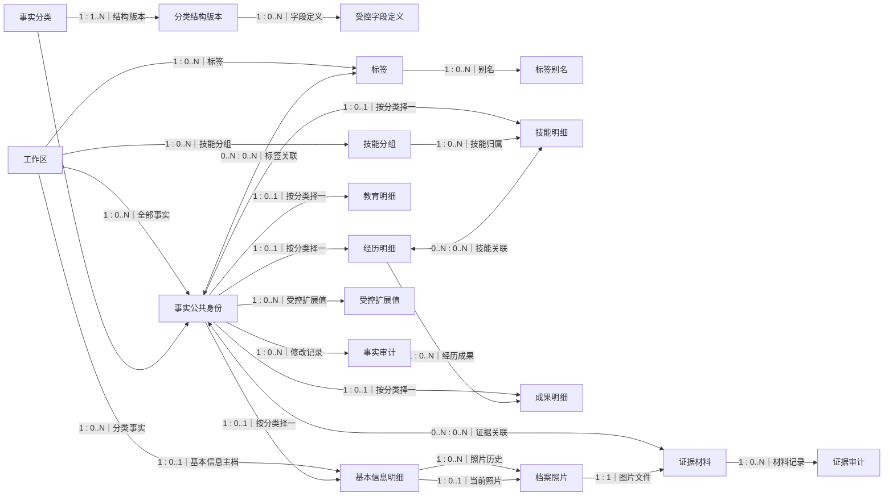
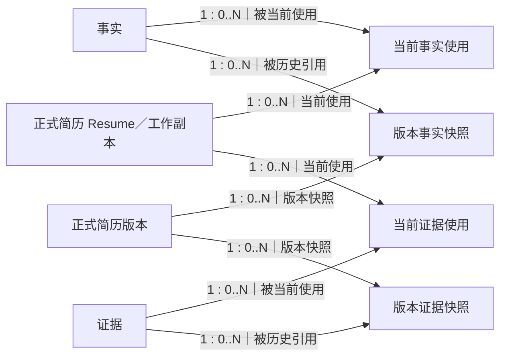
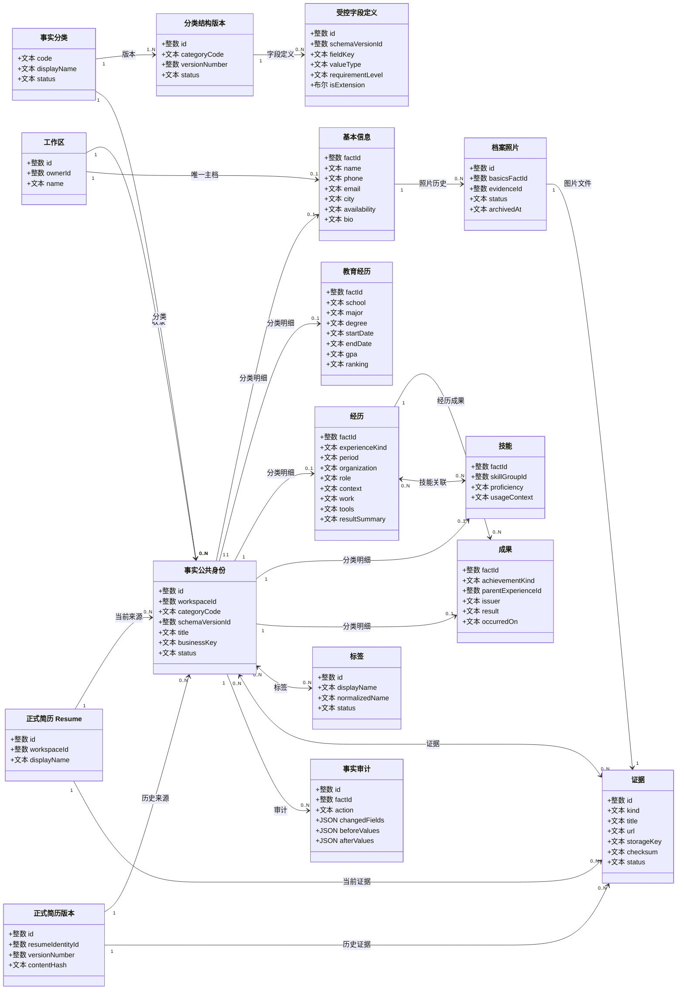

# 资料库中文关系图册

> 文档状态：living-design（配套图册）

> 用途：用中文图表审阅资料库结构和基数，不替代 [目标关系规范](design.md) 或 [schema.sql](schema.sql)。
>
> 原有英文 ER 图保留，不做替换。

## 1. 阅读方式

图中的每一条连线都直接写“左侧实体数量 : 右侧实体数量”。

| 写法 | 含义 |
| --- | --- |
| `1 : 1` | 左侧每条记录恰好对应右侧一条记录 |
| `1 : 0..1` | 左侧每条记录最多对应右侧一条记录 |
| `1 : 0..N` | 左侧每条记录可以没有，也可以对应多条右侧记录 |
| `1 : 1..N` | 左侧每条记录至少对应一条、可以对应多条右侧记录 |
| `0..N : 0..N` | 两侧都可以有多条，通过关联表连接 |

例如“工作区 → 基本信息：`1 : 0..1`”表示一个工作区最多有一份非终态基本信息主档。

## 2. 中文实体关系图

### 2.1 资料域主关系

关键读法：

- 事实公共身份与五个分类明细是“按分类择一”的 `1 : 0..1`，不能同时拥有两个分类明细。
- 一条经历可以没有成果，也可以有多个成果；一个成果最多属于一条主导经历。
- 经历和技能是多对多；标签和证据也都是可复用关系。
- 基本信息按工作区唯一，而不是作为普通事实无限新增。
- 换照片时旧照片进入历史，当前照片最多一张，原图仍保留。

### 2.2 资料域与简历的边界

简历正文和正式版本仍保存自己的内容快照。这里的四类关系只负责来源追踪、引用提醒、证据展示和清理保护，不会让资料库反向覆盖简历正文。

## 3. 中文 UML 类图

这张图强调对象、关键字段和对象的数量关系；完整物理列仍以 [schema.sql](schema.sql) 为准。

## 4. 必要字段表

### 4.1 公共身份与字典

| 实体 | 必要字段 | 约束 |
| --- | --- | --- |
| 工作区 | `id`, `owner_id`, `name`, `created_at` | 工作区是全部资料和标签的隔离边界 |
| 事实分类 | `code`, `display_name`, `sort_order`, `status` | `code` 固定为五个受控值 |
| 分类结构版本 | `id`, `category_code`, `version_number`, `status`, `note` | 同分类版本号唯一；每个分类至多一个 published |
| 受控字段定义 | `id`, `category_code`, `schema_version_id`, `field_key`, `label`, `value_type`, `requirement_level`, `is_extension`, `storage_table`, `storage_column`, `sort_order` | 同版本 `field_key` 唯一；published/retired 定义不可改 |
| 事实公共身份 | `id`, `workspace_id`, `category_code`, `schema_version_id`, `title`, `business_key`, `source_note`, `status`, `archived_at`, `recycled_at`, `purged_at`, `created_at`, `updated_at` | 非终态事实必须有业务键；同工作区、同分类的业务键唯一 |
| 受控扩展值 | `id`, `workspace_id`, `fact_id`, `category_code`, `schema_version_id`, `field_definition_id`, `text_value`, `numeric_value`, `boolean_value`, `json_value` | 必须匹配同一字段定义和值类型 |

### 4.2 五类分类明细

#### 基本信息

| 字段 | 中文含义 | 类型 |
| --- | --- | --- |
| `name` | 姓名 | 文本 |
| `phone` | 电话 | 文本 |
| `email` | 邮箱 | 文本 |
| `city` | 所在地 | 文本 |
| `desired_city` | 目标城市 | 文本 |
| `birth_date` | 出生日期 | 日期 |
| `age_text` | 年龄 | 文本 |
| `hometown` | 籍贯 | 文本 |
| `identity_status` | 身份状态 | 文本 |
| `graduation_date` | 毕业时间 | 年月 |
| `availability` | 到岗安排 | 长文本 |
| `bio` | 个人简介 | 长文本 |

#### 教育经历

| 字段 | 中文含义 | 类型 |
| --- | --- | --- |
| `school` | 学校 | 文本 |
| `major` | 专业 | 文本 |
| `degree` | 学历 | 文本 |
| `start_date` | 入学时间 | 年月 |
| `end_date` | 毕业时间 | 年月 |
| `period_text` | 展示时间段 | 文本 |
| `gpa` | GPA | 文本 |
| `ranking` | 排名 | 文本 |
| `achievement` | 成绩与成果 | 长文本 |
| `courses` | 相关课程 | 长文本 |

#### 经历

| 字段 | 中文含义 | 类型 |
| --- | --- | --- |
| `experience_kind` | 类型：项目、实习/工作、竞赛、科研、校园/志愿、其他 | 枚举 |
| `period_text` | 展示时间段 | 文本 |
| `start_date` | 开始时间 | 年月 |
| `end_date` | 结束时间 | 年月 |
| `organization` | 组织/公司 | 文本 |
| `role` | 角色 | 文本 |
| `team_size` | 团队规模 | 文本 |
| `context_summary` | 背景 | 长文本 |
| `work_summary` | 具体工作 | 长文本 |
| `tools_summary` | 工具与技术 | 长文本 |
| `result_summary` | 普通结果摘要 | 长文本 |
| `challenge` | 挑战 | 长文本 |
| `solution` | 解决方案 | 长文本 |
| `public_note` | 公开说明 | 长文本 |

#### 技能

| 字段 | 中文含义 | 类型 |
| --- | --- | --- |
| `skill_group_id` | 受控技能分组 | 整数外键 |
| `proficiency` | 熟练程度 | 文本 |
| `usage_context` | 使用场景 | 长文本 |

技能名称保存在事实公共身份的 `title`，不另造重复名称列。

#### 成果

| 字段 | 中文含义 | 类型 |
| --- | --- | --- |
| `achievement_kind` | 荣誉、证书、发表/专利、项目结果、其他 | 枚举 |
| `period_text` | 展示时间段 | 文本 |
| `occurred_on` | 取得日期 | 日期 |
| `issuer` | 颁发方/机构 | 文本 |
| `result_text` | 成果内容 | 文本 |
| `note` | 说明 | 长文本 |
| `experience_fact_id` | 可选主经历 | 整数外键 |

### 4.3 标签、证据和审计

| 实体 | 必要字段 | 约束 |
| --- | --- | --- |
| 技能分组 | `id`, `workspace_id`, `code`, `display_name`, `normalized_name`, `sort_order`, `status` | 同工作区分组代码和规范名唯一 |
| 标签 | `id`, `workspace_id`, `display_name`, `normalized_name`, `status`, `merged_into_tag_id` | 同工作区规范名唯一 |
| 标签别名 | `id`, `workspace_id`, `tag_id`, `alias`, `normalized_alias` | 同工作区标签名与别名共用一个唯一命名空间 |
| 证据 | `id`, `workspace_id`, `kind`, `title`, `url`, `storage_key`, `filename`, `mime_type`, `size_bytes`, `checksum`, `note`, `status`, `created_at`, `updated_at` | 文件、链接、说明字段按 kind 条件必填；材料本体不可变 |
| 档案照片 | `id`, `workspace_id`, `basics_fact_id`, `evidence_id`, `status`, `created_at`, `archived_at` | 只能引用图片文件；每档案最多一张 active，历史照片保留 |
| 事实审计 | `id`, `workspace_id`, `fact_id`, `actor_user_id`, `action`, `schema_version_id`, `changed_fields`, `before_values`, `after_values`, `related_fact_ids`, `reason`, `created_at` | 只追加，不可更新或删除 |
| 证据审计 | `id`, `workspace_id`, `evidence_id`, `actor_user_id`, `action`, `changed_fields`, `before_values`, `after_values`, `reason`, `created_at` | 只追加，不可更新或删除 |

### 4.4 关联与简历边界

| 实体 | 必要字段 | 基数与约束 |
| --- | --- | --- |
| 事实-标签关联 | `workspace_id`, `fact_id`, `tag_id` | 多对多；同一事实和标签只关联一次；只能使用 active 标签 |
| 事实-证据关联 | `id`, `workspace_id`, `fact_id`, `evidence_id`, `relation_note`, `sort_order` | 多对多；同一组合只关联一次 |
| 档案-照片关系 | `id`, `workspace_id`, `basics_fact_id`, `evidence_id`, `status`, `created_at`, `archived_at` | 档案 `1 : 0..1 active`；历史 `1 : 0..N` |
| 经历-技能关联 | `workspace_id`, `experience_fact_id`, `skill_fact_id` | 多对多；只能连接 experience 和 skill 两类事实 |
| 当前事实使用 | `id`, `workspace_id`, `resume_id`, `fact_id`, `section_code`, `block_key`, `display_order`, `fact_content_hash` | Resume `1 : 0..N` 事实 |
| 当前证据使用 | `id`, `workspace_id`, `resume_id`, `evidence_id`, `section_code`, `block_key`, `display_mode`, `label`, `display_order` | Resume `1 : 0..N` 证据；展示方式属于引用关系 |
| 版本事实快照 | `id`, `workspace_id`, `resume_version_id`, `fact_id`, `section_code`, `block_key`, `display_order`, `fact_content_hash` | 正式版本 `1 : 0..N` 事实；快照不可变 |
| 版本证据快照 | `id`, `workspace_id`, `resume_version_id`, `evidence_id`, `section_code`, `block_key`, `display_mode`, `label`, `display_order` | 正式版本 `1 : 0..N` 证据；快照不可变 |

## 5. 最需要记住的关系

1. 工作区 `1 : 0..1` 基本信息主档。
2. 工作区 `1 : 0..N` 事实。
3. 事实 `1 : 0..1` 分类明细，五种明细只能命中一种。
4. 经历 `1 : 0..N` 成果，每个成果最多归属于一条经历。
5. 经历与技能 `0..N : 0..N`。
6. 事实与标签、事实与证据均为 `0..N : 0..N`。

项目主页、代码仓库、视频和证书文件统一作为证据挂到经历或成果，不建立链接事实。
